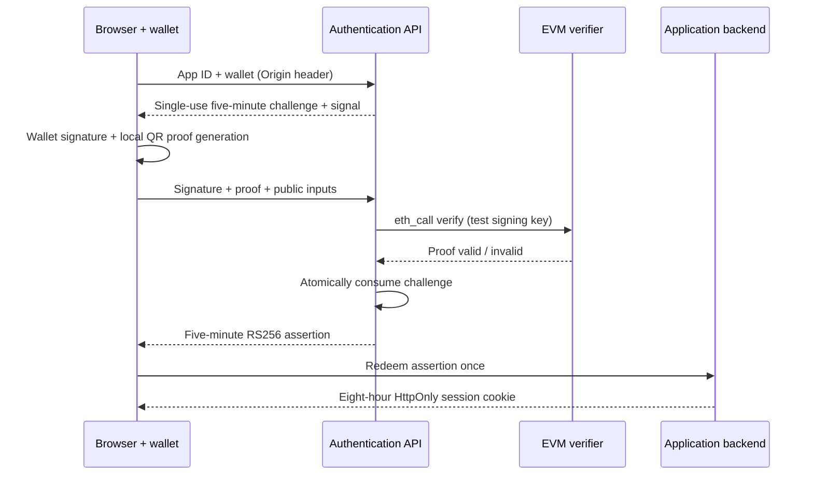

# ProofPass — Aadhaar ZK authentication

A college demonstration and reusable TypeScript/React authentication SDK. Connect a wallet, read a **synthetic Aadhaar QR credential locally**, generate a real Groth16 proof in the browser, verify it through an EVM contract read, and exchange a short-lived assertion for an application session.

**Test credentials — educational demonstration.** This is not a government authentication service or a production identity product. Real Aadhaar documents are outside this version's scope.

## Age rule: an important limitation

Anon Aadhaar 2.4.3's v2 circuit checks **completed age > 18**, using the **date in the signed QR**, not today's login date. An eighteenth-birthday credential is rejected; a nineteenth-birthday credential is accepted. The QR timestamp public input is rounded to the signing hour and converted from IST. We expose the upstream predicate honestly as **19+ at QR signing**. Exact 18+ acceptance would require a different reviewed circuit; changing a JavaScript comparison cannot change what this proof establishes.

Upstream references: [core and contracts](https://github.com/anon-aadhaar/anon-aadhaar), [integration documentation](https://documentation.anon-aadhaar.pse.dev/docs/quick-setup), [age extractor source](https://github.com/anon-aadhaar/anon-aadhaar/blob/main/packages/circuits/src/helpers/extractor.circom).

## Requirements

- Node.js 22 or 24, npm, and Git. Validated here with Node 24.16.0 on Windows.
- Chrome or a browser wallet such as MetaMask. For manual use, configure a **local development wallet**, RPC `http://127.0.0.1:8545`, chain ID `31337`. Never use Hardhat's public development keys for real funds.
- PostgreSQL 17 via Docker, or the included optional embedded PostgreSQL development server.
- About 650 MB for the proving artifacts; several GB of free RAM during proving. Browser timing depends on the device. No custom trusted setup is generated.

## Run locally

Run commands from the repository root. In Windows PowerShell, use `npm.cmd` if script execution policy blocks `npm.ps1`.

```sh
npm ci
npm run build -w @zk-auth/shared
npm run build -w @zk-auth/sdk
npm run keys:generate
npm run fixtures:generate
npm run artifacts:fetch
```

Generate signing keys once; the command refuses to overwrite existing keys. Fixtures are synthetic, signed with the upstream public test key. The download script verifies pinned SHA-256 hashes, caches only public proving artifacts, and links/copies them into both apps' public directories. The signing private key under `.local/` is for application assertions and is ignored by Git.

Start the chain in its own terminal:

```sh
npm run chain
```

In another terminal:

```sh
npm run deploy:local
```

Choose one database option:

```sh
# Option A: PostgreSQL in Docker (start Docker Desktop first)
docker compose up -d
npm run configure:local
```

```sh
# Option B: Docker-free, localhost-only embedded PostgreSQL, in its own terminal
npm run db:local
# Then, in another terminal:
npm run configure:local -- --embedded
```

The embedded server is a development convenience with a connection multiplexer; use regular PostgreSQL for deployment and independent concurrency/load validation. It binds only to `127.0.0.1:5433` and does not provide a production authentication or TLS boundary. Do not run both database options on the same configured URL.

After configuring the database:

```sh
npm run db:migrate
npm run app:register -- demo-a http://localhost:3000
npm run app:register -- demo-b http://localhost:3001
```

Start each service in a separate terminal:

```sh
npm run dev:api
npm run dev:a
npm run dev:b
```

Open [Student Lab](http://localhost:3000) and [Campus Library](http://localhost:3001). Connect the local wallet, sign a challenge, select `fixtures/adult.png` or `fixtures/adult.txt`, generate a proof, then verify and sign in. Use `underage`, `eighteenth-birthday`, and `nineteenth-birthday` fixtures to show the age boundary. QR images are decoded with jsQR in the browser; no file is uploaded. A fresh signed challenge and proof are required for each login. Regenerate the fixtures when demonstrating age boundaries on another date.

`configure:local` updates `.env` and writes each app's ignored `.env.local`. It deliberately points to the latest local deployment. Restart services after changing configuration. A reset Hardhat chain requires redeployment and reconfiguration.

For production-build testing, run `npm run build` after configuration, then `npm run start -w @zk-auth/demo-a` and `npm run start -w @zk-auth/demo-b`. Public Next.js environment variables are embedded at build time.

## How it works



The challenge commits to app ID, allowed origin, wallet, chain ID, verifier address, random nonce, expiry, and app-specific nullifier seed. Its canonical message is hashed to a uint256 signal. Anon Aadhaar commits a further protocol-compatible signal hash inside the proof. The contract reconstructs that hash, so substituting a challenge or wallet breaks verification.

Normal login uses `eth_call`; it makes no blockchain transaction and costs the user no gas. The optional **Publish proof demonstration** button sends a transaction with public proof inputs and emits an event. It does not create an application session. Publishing links the proof inputs to the sender wallet; use it only to illustrate blockchain verification.

The backend explicitly checks the app, origin, signal, seed, age flag, absence of additional disclosure, non-future QR timestamp, and wallet signature. At startup it verifies the RPC chain and wrapper's configured test-key hash. Cryptographic verification uses the test-key-pinned on-chain verifier; malformed or wrong-key proofs cannot authenticate. An unavailable RPC fails closed. The QR signing date is not a freshness assertion: there is no claim that a credential was recently issued or remains current.

## Reuse the SDK

`packages/sdk` builds ESM/CommonJS clients and server helpers, an ESM React component with its worker asset, and declaration files. `packages/shared` supplies shared types. Both remain private packages until you deliberately choose your own publishing scope. React consumers need a bundler supporting `new Worker(new URL(..., import.meta.url))`, as demonstrated by the Next.js apps.

```sh
npm run build -w @zk-auth/shared
npm run build -w @zk-auth/sdk
npm pack -w @zk-auth/shared
npm pack -w @zk-auth/sdk
```

Install both generated tarballs into a consuming project, along with compatible React 18 and wagmi 2. Use the sample apps' Next.js configuration for browser snarkjs resolution and the public test certificate. The browser component requires `WagmiProvider`; initialize wallet transports for your intended test network.

```tsx
import { ZkAuthButton } from '@zk-auth/sdk/react';

<ZkAuthButton
  apiUrl="http://localhost:4000"
  appId="your-app"
  onAuthenticated={async (assertion) => {
    const result = await fetch('/api/session', {
      method: 'POST',
      headers: { 'Content-Type': 'application/json' },
      body: JSON.stringify({ assertion }),
    });
    if (!result.ok) throw new Error('Session exchange failed');
  }}
/>;
```

For lower-level integrations, `ZkAuthClient.challenge(wallet)` returns the message and signal; sign the message, produce a proof with that signal and seed, then call `verify(challengeId, signature, proof)`. No document or birth-date field exists in the API envelope.

On your application backend:

```ts
import { createAssertionVerifier } from '@zk-auth/sdk/server';
const verify = createAssertionVerifier({
  issuer: 'http://localhost:4000',
  audience: 'your-app',
  jwksUrl: 'http://localhost:4000/.well-known/jwks.json',
});
const claims = await verify(assertion);
// Atomically redeem claims.jti once, then issue your own HttpOnly session.
```

The verifier checks signature, RS256 algorithm, issuer, exact audience, expiry, maximum age, required claims, test environment, and age-policy marker. **JWT verification alone does not prevent replay**: copy the transactional redemption/session pattern in the sample server. Keep the assertion in memory, never localStorage. Register the exact allowed app origins through the administrator CLI; re-registering an existing app updates origins but preserves its seed and account identifiers.

## API and storage

| Route                        | Input / result                                                                                                    |
| ---------------------------- | ----------------------------------------------------------------------------------------------------------------- |
| `POST /v1/challenges`        | `{appId, wallet}` plus an allowed `Origin`; returns canonical challenge, expiry, signal, seed, chain and verifier |
| `POST /v1/auth/verify`       | `{challengeId, signature, proof}`; returns `{assertion, expiresIn:300, environment:"test"}`                       |
| `GET /.well-known/jwks.json` | Public RS256 assertion verification key                                                                           |
| `GET /health`                | Process liveness and test environment; not a dependency readiness probe                                           |
| Sample `/api/session`        | `POST` assertion redemption; `GET` session; `DELETE` logout                                                       |

The proof envelope contains `nullifierSeed`, `nullifier`, `timestamp`, `signal`, `reveal` (four public fields), and `groth16` (eight coordinates), all decimal strings. The server rejects unknown fields and out-of-range values. `reveal` must be `["1","0","0","0"]` for authentication.

Errors use `{error:{code}}`: `INVALID_REQUEST`, `ORIGIN_NOT_ALLOWED`, `CHALLENGE_NOT_FOUND`, `CHALLENGE_EXPIRED`, `CHALLENGE_USED_OR_EXPIRED`, `SIGNAL_MISMATCH`, `APP_SEED_MISMATCH`, `AGE_REQUIREMENT_NOT_MET`, `UNEXPECTED_DISCLOSURE`, `INVALID_QR_TIMESTAMP`, `WALLET_MISMATCH`, `WRONG_NETWORK`, `INVALID_PROOF`, `VERIFICATION_UNAVAILABLE`, or `RATE_LIMITED`. A wallet on the wrong chain is also rejected by the browser before signing. Request bodies are never logged. CORS allows browsers to receive errors; authorization independently enforces registered origins.

PostgreSQL stores registered apps, short-lived challenges, assertion redemption IDs, and hashed opaque session tokens with minimum claims. The application subject is SHA-256 over app ID and its protocol nullifier. It is application-specific, not a universal uniqueness guarantee. Reusing a wallet across apps is independently linkable. No name, QR credential, DOB, photograph, address, or Aadhaar number is stored. Expired records can be removed with `npm run db:cleanup`.

## Verification

```sh
npm run typecheck
npm test
npm run contracts:test
npm run proof:validate -- adult
npm run proof:validate -- underage
npm run proof:validate -- eighteenth-birthday
npm run proof:validate -- nineteenth-birthday
npm run contracts:test
npm run test:browser
```

The real-proof commands require downloaded artifacts. They save ignored proof envelopes and timing reports in `.local`. Contract tests explicitly skip real fixtures until those files exist; run them again after generating all four proofs. Browser tests require the chain, deployed wrapper, configured API/database, both apps, and installed Chrome. They use a **test-only injected wallet**, perform actual browser proof generation, check app isolation/logout and underage rejection, exercise the optional local transaction, and inspect API request envelopes. Screenshots go under `.local/`; tracing is disabled to avoid recording 612 MB artifact responses. No test wallet is included in the frontend.

Browser proving runs in an isolated Web Worker with parallelism capped at four. The worker is terminated after completion, failure, or a four-minute timeout; credentials and proofs are never persisted. Changing wallets or networks clears the login state. The worker cap does not modify the circuit or cryptographic verification.

See [validation results](docs/validation.md) and the [college demonstration script](docs/demo-walkthrough.md).

## Sepolia deployment

Set `SEPOLIA_RPC_URL` and a funded **testnet-only** `DEPLOYER_PRIVATE_KEY` in ignored `.env`, then run `npm run deploy:sepolia`. Set API `CHAIN_ID=11155111`, `RPC_URL`, and `VERIFIER_ADDRESS` from `deployments/sepolia.json`. Configure both apps' wagmi RPC and wallet network for Sepolia, register exact HTTPS origins, and set the API/issuer URLs consistently. Serve app/API over HTTPS so secure cookies work. Use regular PostgreSQL, not the development socket adapter. Build again after public environment changes. No Sepolia deployment or testnet funding is included automatically.

## Trust and limits

The proof establishes possession of signed credential data and control of a wallet bound to the challenge. It does not establish rightful credential ownership, biometrics, government OTP authentication, citizenship, credential revocation, or person-level uniqueness. The authentication service is trusted to issue assertions; applications still trust its signing key and deployment configuration. Test-key credentials are forgeable by anyone with the upstream public test private key, by design.

For a real-credential deployment, first choose a circuit meeting the exact age requirement, assess protocol maintenance and audits, review current UIDAI offline-verification requirements, establish signer-key rotation and revocation policies, add operational monitoring, and perform an independent security review. This repository deliberately implements the synthetic educational system only.
